# Nahem Assistant: an Arabic-first ordering chatbot

A bilingual (Arabic / English) customer assistant I built for **[Nahem](https://nahem24.com)**, a 24-hour burger restaurant with two branches in Madinah, Saudi Arabia. It answers customer questions, recommends meals to each customer's needs (gym, diet, healthy eating, allergies), gives full nutrition facts, plans group and budget orders, and turns a conversation into a ready WhatsApp order, all from a single script on the restaurant's static website. The same assistant also runs full screen as an **in-store kiosk** on a tablet or service robot.

**▶ [Live demo with a guided tour](https://mohammed-890.github.io/nahem-chatbot/)**: press *Watch the 60-second tour* and the chatbot demonstrates every feature on its own. **🏪 [In-store kiosk demo](https://mohammed-890.github.io/nahem-chatbot/kiosk.html)**.

<p align="center">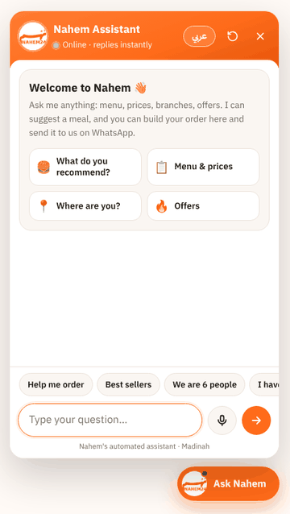</p>

## The problem

Nahem's customers mostly ask the same questions over WhatsApp: *Where are you? Are you open? What do you recommend? What should 9 of us order?* Every one of those messages costs staff time, and late at night (the restaurant is open 24 hours) many go unanswered. The owner wanted an assistant on the website that:

- speaks the customers' language: **Saudi dialect first**, formal Arabic and English too
- knows the real menu, prices and branches, and **never invents an answer**
- moves the customer towards an order, not just a reply
- costs nothing to run and needs no developer to maintain

## What it does

| | |
|---|---|
| 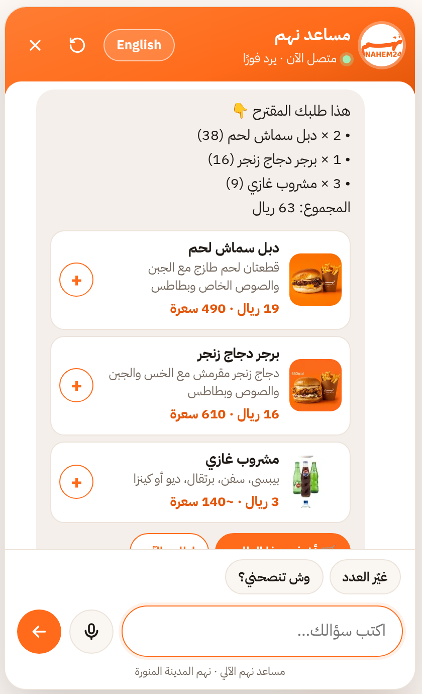 | **🧭 Guided ordering.** "ساعدني أطلب" (help me order) asks how many people and chicken / beef / mix, then builds a priced basket that one tap adds to the order. |
| 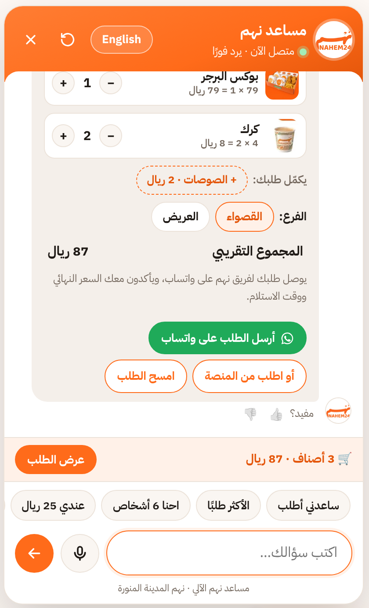 | **🛒 Chat-to-WhatsApp orders.** Add items with **+** or by typing "add 2 zinger" (multi-item: "3 بوكس برجر و 2 خفايف"). Pick a branch and the whole order is sent to the restaurant's WhatsApp, formatted and totalled. The basket suggests missing extras (drink, fries, sauce), and returning customers can reorder their last order in one tap. |
| 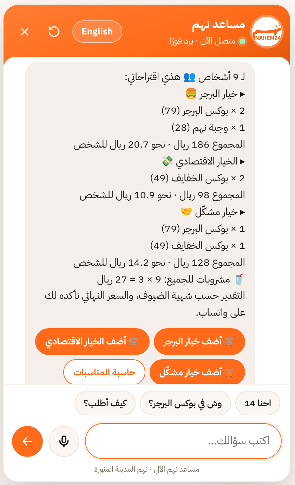 | **👥 Group & budget planner.** "احنا 9 أشخاص" (we are 9) returns three priced plans with cost per person. "I only have 50 riyals" builds the best meal within budget. Breakfast groups get breakfast plans. |
| 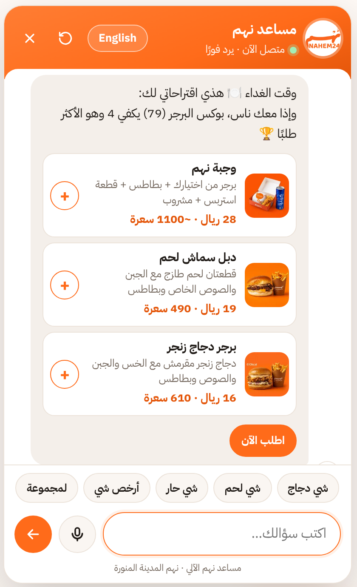 | **🍔 Smart recommendations.** Suggestions change with the time of day in Madinah (breakfast, lunch, dinner, late night), plus filters for spicy, chicken, beef, vegetarian, light, kids and desserts, best sellers, cheapest and most filling. |
| 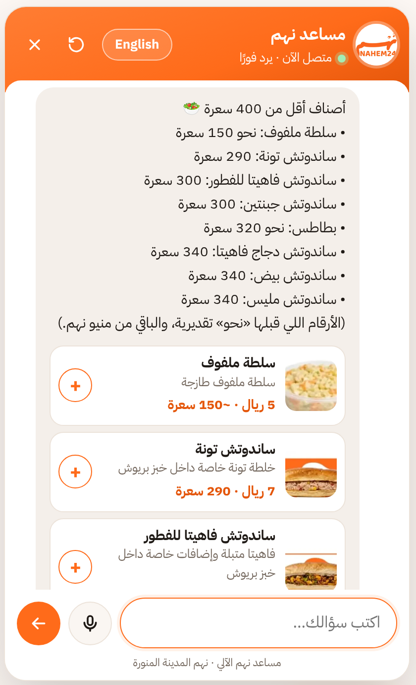 | **🎯 Sells to each customer's needs.** "I go to the gym" gets the highest-protein items and protein tips; "I'm on a diet" gets fewer calories with protein that keeps you full; healthy eating, low-carb, diabetes (low sugar) and blood pressure (low salt) each get their own picks. "Will the tuna sandwich fill me up?" gets an honest answer and a bigger option. The goal is remembered for the rest of the chat. |
| 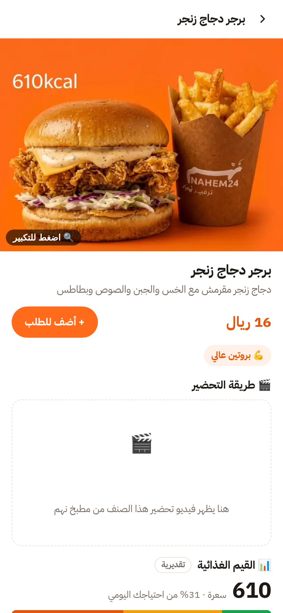 | **📊 Nutrition, ingredients & allergens.** Every item has a product sheet: a close-up photo with tap-to-zoom, calories and their breakdown (protein, carbs, fat), fibre, sugar and salt against daily values, a fullness meter, the ingredients, allergens, and a slot for the kitchen's preparation video. "Is the zinger gluten free?" or "I'm lactose intolerant" lists what to avoid and the alternatives, always with a reminder to confirm severe allergies with staff. |
| 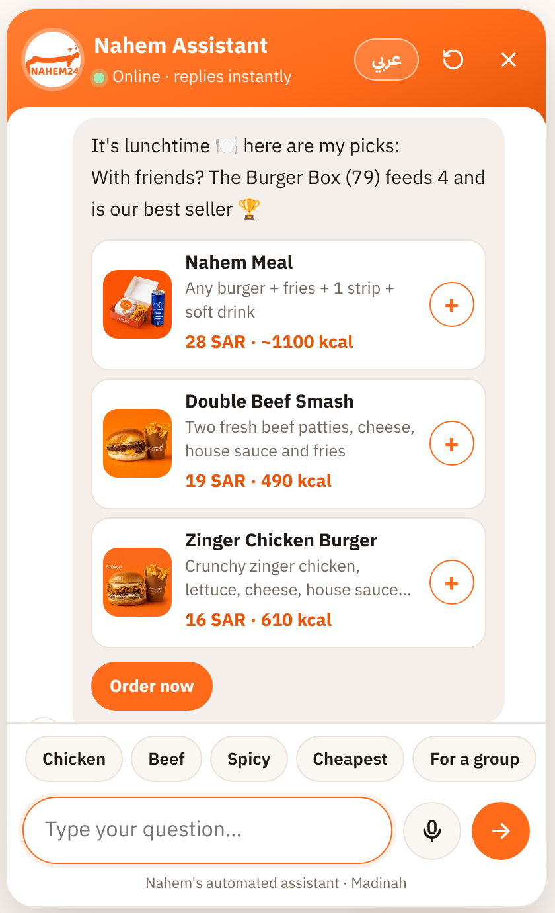 | **✍️ Typos, dialects and English.** Understands "what do u reccomeed", "الفروووع", Gulf dialect, formal Arabic ("لا أملك سوى 50 ريالًا") and English, and switches language on request. |
| | **🧮 Smarter conversations.** Two questions in one message ("where are you and when do you open?") get one combined answer. "How much for 2 burger boxes and 3 fries?" works out the total. "Surprise me" picks a meal for the time of day, "is the zinger any good?" gets an honest recommendation, and "one more" adds another of the last item. |
| 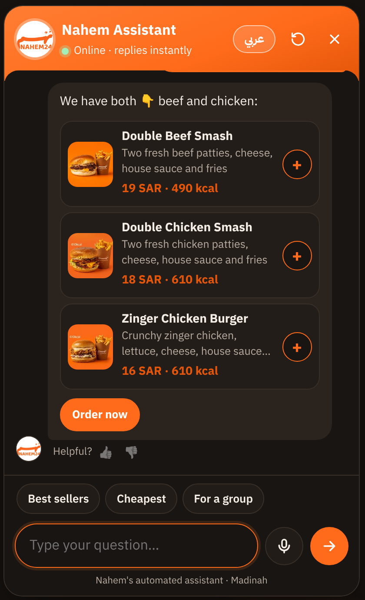 | **🎙️ Voice, photos and dark mode.** Speak in Arabic or English, food photos on every item card, follows the visitor's dark mode, full screen on phones, sits above the site's own mobile bar. |

### On the restaurant's website

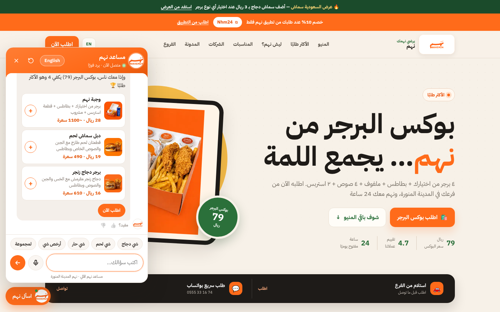

<p align="center">
  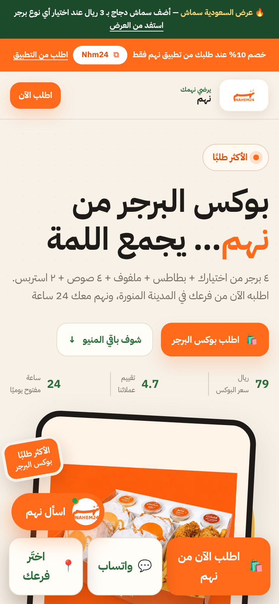
  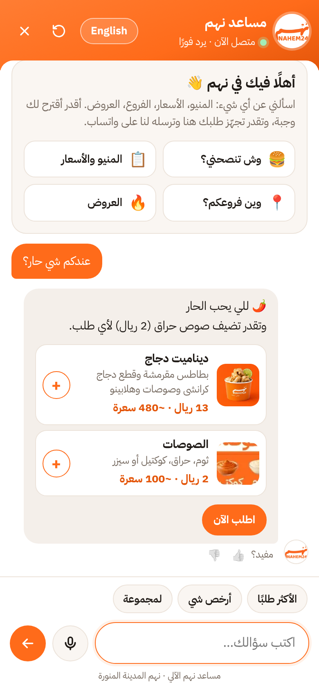
</p>

### In the restaurant: the kiosk

`kiosk.html` runs the same assistant full screen on a tablet, a smart display or the screen of a service robot. It greets people with rotating food photos, speaks its answers (speech synthesis) and listens (voice input), starts with "what are you looking for?" (protein, diet, allergies, best sellers, groups), and resets itself between customers after a "still there?" prompt. Confirming an order shows an order number and a QR code that sends the order to the restaurant's WhatsApp from the customer's own phone. Staff settings (branch, language, spoken replies, an optional camera greeting that only detects movement on the device) open by holding the top-left corner.

<p align="center">
  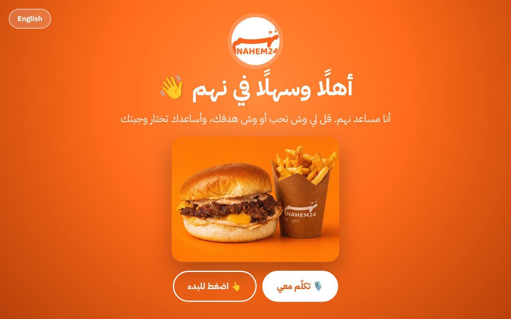
  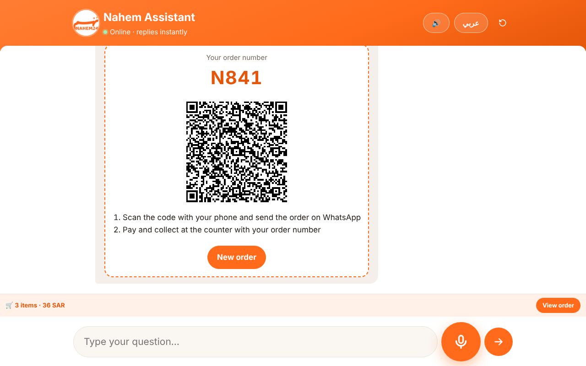
</p>

## How it works

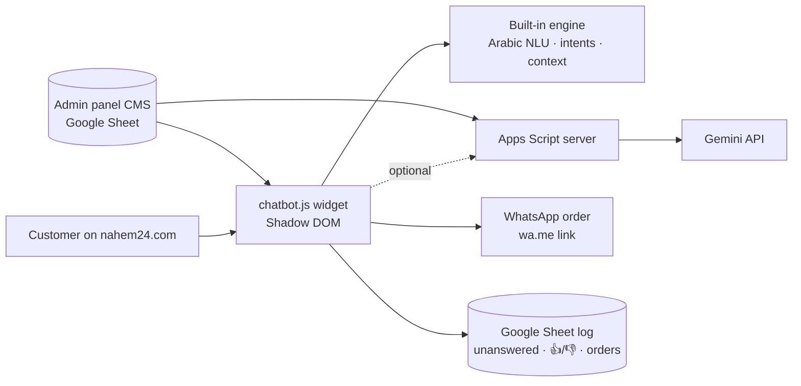

- **One drop-in script.** `chatbot.js` is plain JavaScript with no build step and no dependencies. It is added to every page with a single `<script>` tag and renders in a Shadow DOM, so it can't clash with the site's CSS.
- **My own Arabic language engine.** The built-in engine handles every answer without an API:
  - Arabic normalisation: alef and taa marbuta forms, diacritics, stretched letters ("الفروووع"), Eastern digits.
  - Word matching at Arabic word starts with attached prefixes (و، ب، ال، لل…), so "كم" (how much) doesn't match inside "عليكم".
  - Typo tolerance with Levenshtein distance plus consonant skeletons for English ("reccomeed" → recommend), with guards against false matches ("brnaches" is not "franchise").
  - Ordered intents, follow-up context ("كم سعره؟" (how much is it?) refers to the last item; "و 15؟" (and 15?) continues a group plan), and entity parsing for quantities, budgets and group sizes, including numbers written as words ("خمسين ريال", fifty riyals).
- **Live data.** The restaurant edits prices and branches in its existing admin panel (a Google Apps Script CMS). The chatbot reads the same published content, so menu changes reach it automatically.
- **Optional AI layer.** `server/Code.gs` is a Google Apps Script web app. It keeps the Gemini API key server-side, builds the prompt from the live menu, rate-limits requests and logs to a Google Sheet. If the AI is slow or over quota, the built-in engine answers instead, so a customer is never left without a reply.
- **Analytics.** Opening the chat, messages, add-to-order, WhatsApp orders, feedback and unanswered questions are sent as Google Analytics / GTM events.

## Testing

I tested the engine against **450+ customer-style questions**: Saudi dialect, formal Arabic and English, with typos, follow-ups and edge cases. Each change was regression-diffed: every answer before and after was compared, so a fix in one place couldn't silently break another. The UI was tested end to end in headless Chromium: ordering, WhatsApp message contents, persistence across pages, voice input (with a simulated speech engine) and the mobile layout.

## Project structure

```
src/chatbot.js     the widget and the built-in engine (drop-in script)
server/Code.gs     optional Apps Script backend: Gemini + Google Sheet log
docs/              the live demo (GitHub Pages) with the guided tour
docs/kiosk.html    the in-store kiosk (full screen, voice, QR order ticket)
screenshots/       images used in this README
```

## Installing on a site

1. Copy `chatbot.js` to the site root and the food photos to `assets/chat/`.
2. Add one line before `</body>`:
   ```html
   <script src="/chatbot.js" defer></script>
   ```
3. Optional: deploy `server/Code.gs` as an Apps Script web app and set `chatUrl` in the site's `config.js` to turn on the AI answers and the Google Sheet log.

## Notes

- The menu, prices, branches, logo and food photos belong to Nahem.
- Calories marked "about" are estimates for the demo; the others come from the restaurant's printed menu. Protein, carbs, fat, fibre, sugar, salt, ingredients and allergens are demo estimates built from the menu descriptions (flagged as estimates in the chat) until the kitchen supplies lab values: they live in one table (`NUTRITION`, `RECIPE`) at the top of `chatbot.js`.
- WhatsApp buttons in the demo open a real chat with the restaurant, so please don't send test orders.

## Author

**Mohammed Banabilh** · Final-year BSc Computer Science with AI, Sheffield Hallam University · [GitHub](https://github.com/Mohammed-890)

Built with AI pair-programming (Claude Code).
